# SIEM Home Lab: Endpoint Detection and Security Monitoring on a Home Network

A self-hosted SIEM (built on open-source Wazuh 4.14) running on an Ubuntu Server VM, collecting security events from a Windows endpoint and detecting simulated attacker activity (local account creation, privilege escalation, failed logons, and account deletion), with each alert tagged by Wazuh with its MITRE ATT&CK technique.

---

## The Business Problem This Lab Solves

Most breaches aren't silent. They leave evidence in logs: a new admin account nobody requested, a run of failed logons, an account created and deleted within minutes. The problem is that those logs sit on individual machines where nobody reads them. Without central collection and alerting, an organization finds out about an intrusion weeks later, from a customer, a bank, or a ransom note.

Small and mid-sized organizations feel this most. They often can't justify commercial SIEM licensing or a 24/7 security operations center, yet they still face the same attackers. They also face the same audit questions: frameworks like PCI DSS, HIPAA, and SOC 2 all expect logs to be collected centrally, reviewed, and retained.

This lab builds the core of a security monitoring pipeline from zero, using open-source tooling: a central SIEM server, an endpoint agent, log collection, detection rules, severity-based alerting, and a validated detection test. Every step maps to what a security or systems team does when they stand up monitoring in production.

---

## How This Lab Solves It

Each challenge from the business problem maps to a specific part of this build, and a screenshot from the running lab proves it.

| Business challenge | Solution in this lab | Proof |
|---|---|---|
| **Logs are scattered across machines and nobody reviews them** | Wazuh agent on the Windows endpoint forwards Security event logs to a central Wazuh manager | Agents summary shows **1 active, 0 disconnected** ([15](docs/images/15-overview-one-active-agent.png)) |
| **Detect attacker behavior quickly, not weeks later** | Built-in Wazuh rules for Windows account management and logon events | All four simulated attacker actions generated alerts ([18](docs/images/18-detection-test-results.png)) |
| **Separate what matters from noise** | Severity levels: the Administrators group change is rated **level 12 (High)**, while a single failed logon is level 5 | Detection results table ([18](docs/images/18-detection-test-results.png)) |
| **Know your security posture, not just incidents** | Security Configuration Assessment (CIS benchmark) and vulnerability detection run automatically on enrollment | **473 medium / 316 low** baseline findings in the first 24 hours ([16](docs/images/16-alerts-by-severity-24h.png), [17](docs/images/17-medium-alerts-baseline-spike.png)) |
| **Speak a common language for threats** | Wazuh's built-in rules tag each alert with a MITRE ATT&CK technique (T1136.001, T1098, T1110, T1531), which I reviewed for each detection | [Detection Test 1](#step-8-detection-test-1--simulated-attacker-account-activity) |
| **Monitoring without commercial licensing** | Open-source Wazuh on a free Ubuntu Server VM | Full stack built on a single home PC |

### Outcome

Starting from an empty VirtualBox install, the lab delivers a working SIEM with an enrolled Windows endpoint, a baseline of configuration and vulnerability findings, and a passing detection test. Six alerts fired for four attacker actions, and the highest-risk action, granting a new account admin rights, was correctly flagged as high severity. Every problem hit along the way is documented with its root cause and fix.

---

## Architecture

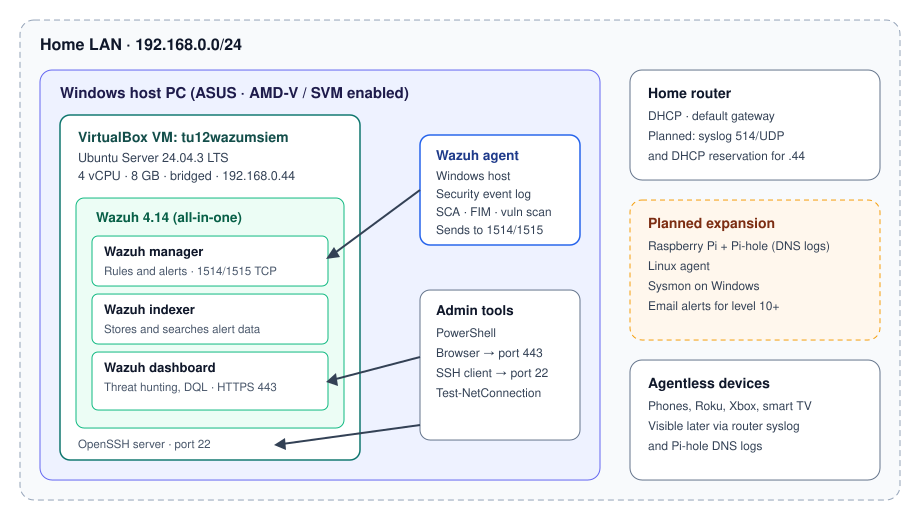

| Component | Detail |
|---|---|
| **Host** | Windows PC (ASUS, AMD CPU) with AMD-V / SVM enabled in UEFI |
| **Hypervisor** | Oracle VirtualBox |
| **SIEM VM** | `tu12wazumsiem`: Ubuntu Server 24.04.3 LTS, 4 vCPU, 8 GB RAM, 50 GB disk |
| **Network** | Bridged adapter, `192.168.0.44` on the home LAN |
| **SIEM** | Wazuh 4.14 all-in-one: manager, indexer, and dashboard on one host |
| **Endpoint** | Windows host with the Wazuh agent |
| **Admin access** | SSH from Windows PowerShell (OpenSSH server on the VM) |

### Ports

| Port | Protocol | Purpose |
|---|---|---|
| 1515 | TCP | Agent enrollment |
| 1514 | TCP | Agent → manager event traffic |
| 443 | TCP | Wazuh dashboard (HTTPS) |
| 22 | TCP | SSH administration |

---

## Features

| Area | What the lab does |
|---|---|
| **Central log collection** | Windows Security events forwarded from the agent to the Wazuh manager |
| **Detection rules** | Wazuh's built-in Windows ruleset detects account creation, group changes, logon failures, and deletions |
| **Severity-based alerting** | Alerts grouped as Low (0–6), Medium (7–11), High (12–14), Critical (15+) |
| **MITRE ATT&CK mapping** | Detections tagged with technique IDs for coverage analysis |
| **Configuration assessment** | CIS benchmark checks run against the endpoint automatically |
| **Vulnerability detection** | Installed software checked against known CVEs |
| **Threat hunting** | DQL queries in the dashboard to filter by event ID, rule, agent, and severity ([saved queries](detections/queries.md)) |
| **Repeatable testing** | PowerShell script to reproduce the detection test (not yet tested) ([script](scripts/Invoke-AccountDetectionTest.ps1)) |
| **Health checks** | Bash and PowerShell scripts to check server services, ports, agent status, and connectivity |

---

## Tech Stack

Wazuh 4.14 (manager, indexer, dashboard) · Ubuntu Server 24.04.3 LTS · Oracle VirtualBox · Windows · PowerShell · Bash · OpenSSH · ufw · Windows Security auditing (`auditpol`) · MITRE ATT&CK

---

## Repository Structure

```
.
├── README.md
├── scripts/
│   ├── server-healthcheck.sh            # Wazuh services, ports, firewall, agents, resources
│   ├── Test-WazuhConnectivity.ps1       # Endpoint → manager port tests + agent diagnostics
│   ├── Register-WazuhAgent.ps1          # Set manager address and enroll/re-enroll an agent
│   └── Invoke-AccountDetectionTest.ps1  # Detection Test 1 (4720, 4732, 4625, 4726)
├── detections/
│   └── queries.md                       # Saved DQL queries, Event IDs, severity bands
└── docs/images/                         # Architecture diagram + build screenshots
```

---

## Build Walkthrough

### Step 1: Create the VM and select the right ISO

VirtualBox doesn't ship with any operating systems, so the **ISO Image** field starts empty:

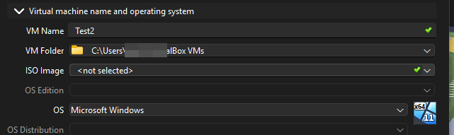

Double-clicking the ISO in Windows **mounts** it as a DVD drive instead of handing it to VirtualBox. The `.iso` file itself has to be selected in VirtualBox:

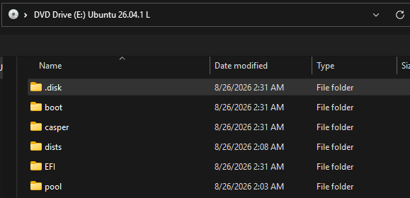

My first download was **Ubuntu 26.04.1 Desktop**. Wazuh's quickstart only lists support up to Ubuntu 24.04, and a desktop environment wastes RAM and CPU the SIEM needs:

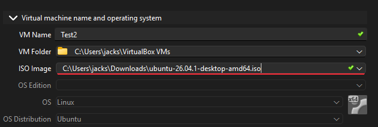

Switched to **Ubuntu Server 24.04.3 LTS** (`live-server`), which Wazuh supports:

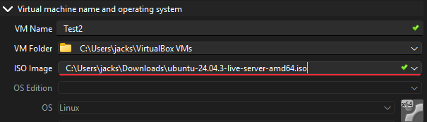

**VM settings:** 4 vCPU · 8192 MB RAM · 50 GB disk · Skip Unattended Installation · Network: **Bridged Adapter**

### Step 2: Enable hardware virtualization

The first boot failed with `VERR_SVM_DISABLED`, meaning AMD-V was turned off in the firmware:

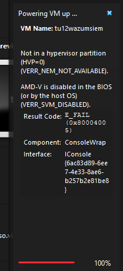

**Fix (ASUS UEFI):** F2 at boot → F7 (Advanced Mode) → **Advanced > CPU Configuration > SVM Mode → Enabled** → F10 save. Checked in Task Manager > Performance > CPU: *Virtualization: Enabled*.

### Step 3: Install Ubuntu Server

The installer finishes by downloading security updates. This step looks stalled but isn't:

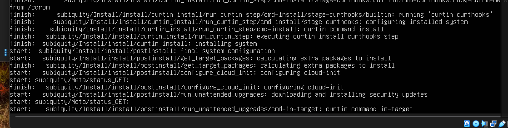

During boot, the kernel reported **RCU CPU stall** warnings. The VM wasn't getting enough CPU time from the host (resource contention or Hyper-V sitting underneath VirtualBox):

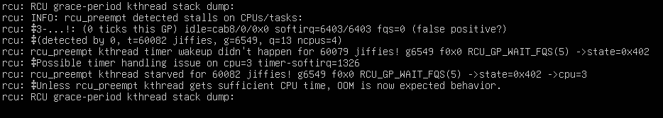

The system recovered and reached the login prompt:


```bash
sudo apt update && sudo apt upgrade -y
```

### Step 4: Fix networking (NAT → Bridged)

`ip a` showed `10.0.2.15`, VirtualBox's **NAT** default. In NAT mode, nothing on the LAN can reach the VM, so neither the dashboard nor the agents would work:

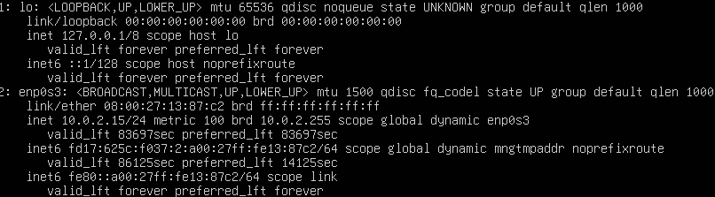

**Fix:** `sudo poweroff` → VirtualBox **Settings > Network > Adapter 1 > Bridged Adapter** (active NIC) → boot → `ip a` now shows **`192.168.0.44`**, assigned by the router.

### Step 5: Set up SSH administration

The VirtualBox console doesn't support copy/paste, so I managed the server from Windows PowerShell over SSH. My first attempt used the placeholder brackets literally, and PowerShell treats `<` as a reserved operator:

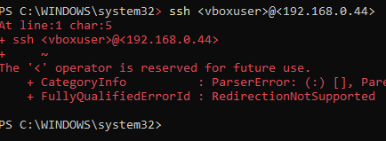

With the correct syntax, the connection was **refused**. The network was fine, but nothing was listening on port 22 because the unattended install had skipped OpenSSH:

```bash
sudo apt install -y openssh-server
sudo systemctl enable --now ssh
sudo ss -tlnp | grep :22
```

```powershell
ssh vboxuser@192.168.0.44
```

### Step 6: Install Wazuh (all-in-one)

```bash
curl -sO https://packages.wazuh.com/4.14/wazuh-install.sh && sudo bash ./wazuh-install.sh -a
```

The installer deploys the indexer, manager, and dashboard, then prints the `admin` password. The dashboard is at `https://192.168.0.44`. The self-signed certificate warning is expected in a lab.

> Recover the password later with `sudo tar -O -xvf wazuh-install-files.tar wazuh-install-files/wazuh-passwords.txt`. Never commit this file.

### Step 7: Enroll the Windows agent

I deployed the agent with **Endpoints > Deploy new agent** and started the service from an administrator prompt:

```powershell
NET START WAZUH     # start the agent
NET STOP WAZUH      # stop the agent
```

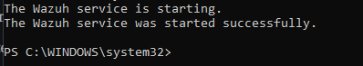

…but the dashboard showed **no agents**:

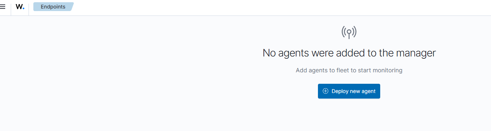
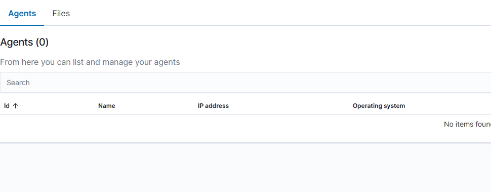

**Isolating the layer.** A typo (`-Port1515`) cost one attempt:

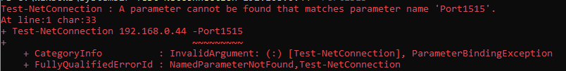

With the typo fixed, both ports returned `TcpTestSucceeded : True`, which ruled out the network. The problem had to be on the agent: no manager address, or never enrolled.

```powershell
Test-NetConnection 192.168.0.44 -Port 1515
Test-NetConnection 192.168.0.44 -Port 1514
```

**Fix:** set the manager address and enroll manually ([`Register-WazuhAgent.ps1`](scripts/Register-WazuhAgent.ps1) automates this):

```powershell
NET STOP WAZUH
(Get-Content "C:\Program Files (x86)\ossec-agent\ossec.conf") -replace '<address>.*</address>', '<address>192.168.0.44</address>' | Set-Content "C:\Program Files (x86)\ossec-agent\ossec.conf"
& "C:\Program Files (x86)\ossec-agent\agent-auth.exe" -m 192.168.0.44
NET START WAZUH
```

**Result: 1 active agent.**

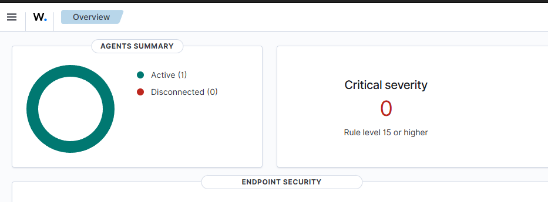

### Step 8: Detection Test 1 – simulated attacker account activity

**Baseline first.** Within 24 hours of enrollment the dashboard showed **473 medium** and **316 low** alerts, with no high or critical:

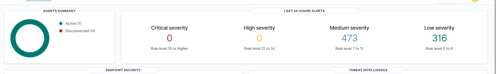

Drilling into the medium alerts showed a single spike at the moment of enrollment: the first configuration-assessment (CIS benchmark) and vulnerability scans, not an attack:

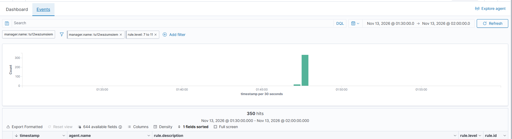

**The test.** I used a throwaway account, so my own account couldn't be locked out ([script version](scripts/Invoke-AccountDetectionTest.ps1)):

```powershell
net user testadmin P@ssw0rd123! /add              # Event 4720
net localgroup administrators testadmin /add      # Event 4732
runas /user:testadmin cmd                         # wrong password → Event 4625
net user testadmin /delete                        # Event 4726
```

**Detection query:**

```
data.win.system.eventID: (4625 or 4720 or 4732 or 4726)
```

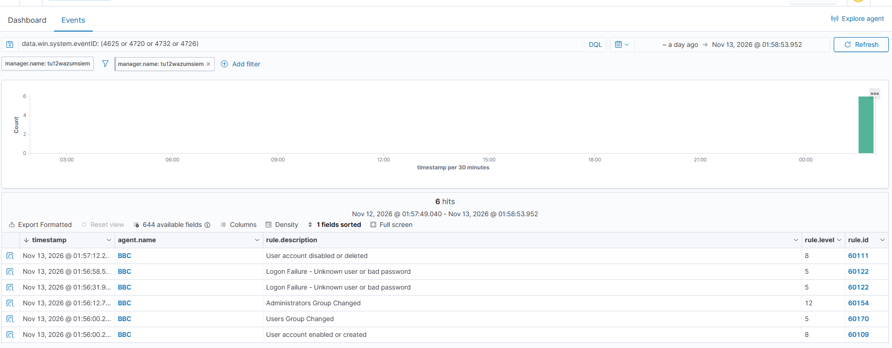

| Time | Rule ID | Level | Description | Event | MITRE ATT&CK |
|---|---|---|---|---|---|
| 01:56:00 | 60109 | 8 | User account enabled or created | 4720 | T1136.001 – Create Account: Local Account |
| 01:56:00 | 60170 | 5 | Users Group Changed | 4732 | T1098 – Account Manipulation |
| 01:56:12 | 60154 | **12** | Administrators Group Changed | 4732 | T1098 – Account Manipulation |
| 01:56:31 | 60122 | 5 | Logon Failure – Unknown user or bad password | 4625 | T1110 – Brute Force |
| 01:56:58 | 60122 | 5 | Logon Failure – Unknown user or bad password | 4625 | T1110 – Brute Force |
| 01:57:12 | 60111 | 8 | User account disabled or deleted | 4726 | T1531 – Account Access Removal |

**Result: PASS.** All four actions were detected.

**Analysis**
- **The admin group change was the only high-severity alert.** A new account gaining admin rights is a classic privilege-escalation and persistence sign, and the severity should reflect that.
- **Account creation produced two alerts.** Windows automatically adds new local users to the built-in Users group.
- **Single failed logons are low severity by design,** since users mistype passwords all day. Only two were generated, which isn't enough to trigger Wazuh's correlated brute-force rule.
- **Create → escalate → delete within about 70 seconds** is a pattern that, in production, suggests someone covering their tracks.

**How I'd triage this in a SOC:** pivot on the host and time window → check `subjectUserName` to see who ran the commands → confirm whether there was an approved change → if not, isolate the host, reset credentials, and hunt for persistence.

---

## Mistakes I Made and What They Taught Me

| # | Mistake / issue | Root cause | Fix | Lesson |
|---|---|---|---|---|
| 1 | Double-clicked the ISO and Windows mounted it as drive E: | Windows auto-mounts ISO files | Ejected it; selected the `.iso` file in VirtualBox | The hypervisor needs the image file, not its contents |
| 2 | Downloaded Ubuntu **26.04 Desktop** | Grabbed the newest release without checking support | Switched to **24.04 Server** | **Check the vendor support matrix before you build.** Server images for servers |
| 3 | `VERR_SVM_DISABLED` on first boot | AMD-V/SVM off in UEFI | Enabled SVM Mode in ASUS BIOS | Hardware virtualization is a prerequisite; verify it in Task Manager |
| 4 | RCU CPU stall warnings | VM starved of CPU time on the host | Waited for recovery; noted host and VM tuning options | Size VMs against host capacity; Hyper-V under VirtualBox hurts performance |
| 5 | VM got `10.0.2.15` | Adapter left on default NAT | Switched to Bridged | **Confirm the network mode with `ip a` before installing services** |
| 6 | Typed `ssh <vboxuser>@<192.168.0.44>` | Copied placeholder brackets literally | Removed brackets | `<value>` in docs is a placeholder; `<` is reserved in PowerShell |
| 7 | SSH **connection refused** | OpenSSH not installed (unattended install) | Installed and enabled `openssh-server` | **Refused = service/port problem; timed out = network/firewall problem** |
| 8 | Agent "started" but dashboard showed **0 agents** | Agent never enrolled / no manager address | Set `<address>`, ran `agent-auth.exe`, restarted | **"Service running" ≠ "connected."** Test ports to isolate the layer |
| 9 | `Test-NetConnection ... -Port1515` | Missing space before the value | `-Port 1515` | Small syntax errors look like real failures; read the error text |
| 10 | Looked for test events in the wrong view | Medium-severity filter and a narrow time window hid level-5 events | Removed the filter, widened the time range, searched by Event ID | **Filters can hide the evidence you're looking for** |
| 11 | Only 2 failed logons captured | Didn't repeat enough times quickly | Planned a re-test with rapid attempts | Correlation rules need volume within a time window |

**My troubleshooting method, refined by this build:**
`hardware → hypervisor → OS → network (ip a) → service (systemctl) → port (ss / Test-NetConnection) → firewall (ufw) → application config`

---

## Skills Demonstrated

| Area | Skills |
|---|---|
| **Security operations** | SIEM deployment, agent enrollment, alert triage, severity analysis, reading MITRE ATT&CK technique tags, DQL threat hunting, detection testing, baseline-vs-incident analysis |
| **Windows security** | Security Event IDs (4625, 4720, 4732, 4726), audit policy (`auditpol`), local account and group management, PowerShell service control, agent config (`ossec.conf`) |
| **Linux administration** | Ubuntu Server install and patching, `systemctl`, `ip`, `ss`, `ufw`, OpenSSH server, reading install logs |
| **Networking** | NAT vs. Bridged, DHCP, TCP port testing, refused vs. timeout diagnosis, service port mapping (22/443/1514/1515) |
| **Virtualization** | VM sizing against vendor requirements, ISO selection, UEFI virtualization (AMD-V/SVM), CPU contention diagnosis |
| **Automation (in progress)** | PowerShell and Bash helper scripts for enrollment, connectivity testing, health checks, and detection tests. These are written but not yet tested in the lab |
| **Documentation** | Root-cause analysis, step-by-step runbook with screenshots, findings table, SOC triage plan |

---

## Applying This to Real Business Problems

| Scenario | How this lab's skills apply |
|---|---|
| **Small business with no security monitoring** | Stand up Wazuh on one server or cloud VM, deploy agents to staff laptops and servers, and alert on admin group changes and brute-force attempts. Visibility for the cost of a VM, not a license |
| **Insider threat / unauthorized admin access** | The level-12 *Administrators Group Changed* rule catches privilege escalation the moment it happens, whether it's an attacker or an employee bypassing change control |
| **Compliance audits (PCI DSS, HIPAA, SOC 2)** | Central log collection, retention, and searchable evidence answer "show me who created accounts and when" in minutes instead of days |
| **Ransomware early warning** | Account creation, privilege escalation, and logon failures are common early steps before encryption. Detecting them gives the team time to respond |
| **Hardening backlog** | The 473 baseline configuration findings become a prioritized remediation list, measured against the CIS benchmark |
| **Help desk / sysadmin efficiency** | The same layered troubleshooting (network → service → config) applies to any "it says it's running but it's not working" ticket |

---

## Roadmap

| Item | Status |
|---|---|
| Ubuntu Server VM, bridged networking, SSH admin | ✅ Done |
| Wazuh 4.14 all-in-one install | ✅ Done |
| Windows agent enrolled | ✅ Done |
| Detection Test 1 (account activity) | ✅ Done – PASS |
| DHCP reservation for the SIEM, SSH key auth, password login disabled | 🔲 Planned |
| Sysmon on Windows for process and command-line visibility | 🔲 Planned |
| Brute-force correlation test (rapid failed logons) | 🔲 Planned |
| Linux agent | 🔲 Planned |
| Router syslog → Wazuh | 🔲 Planned |
| Raspberry Pi + Pi-hole, DNS logs into Wazuh | 🔲 Future |
| Email alerts for level 10+ | 🔲 Future |

---

## Security Notes

- Nothing in this lab is exposed to the internet. There is **no port forwarding** for the dashboard (443) or SSH (22).
- Wazuh credentials are generated at install and stored in a password manager, never in this repo (see `.gitignore`).
- Detection tests run only on machines I own, with a temporary account that is deleted at the end.
